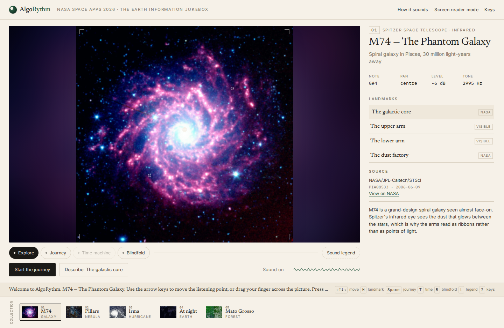

# AlgoRythm

**Hear the planet.** NASA imagery, read out loud.

Built for the 2026 NASA Space Apps Challenge — [The Earth Information Jukebox](https://www.spaceappschallenge.org/2026/challenges/the-earth-information-jukebox/).



---

## What it is

AlgoRythm turns NASA images into music you can steer. You move a point across a picture; the point
becomes a voice. Where it is in the frame decides the pitch and the stereo position, how bright the
picture is there decides the loudness and the tone, and the colour decides which of four instruments
you hear. Nothing is decoration and nothing is random: every sound is a measurement.

It is built for people who cannot see the picture — and for everyone else, because hearing a
hurricane's structure is a different kind of understanding from looking at it.

## The collection

Five scenes, all real NASA data, all self-hosted, all with hand-written landmarks:

| # | Scene | NASA product |
|---|---|---|
| 01 | **M74**, the Phantom Galaxy | Spitzer, `PIA08533` |
| 02 | **Pillars of Creation**, near-infrared | Hubble, `GSFC_20171208_Archive_e000842` |
| 03 | **Hurricane Irma**, 6 Sept 2017 | MODIS Terra via GIBS |
| 04 | **Earth at Night** | VIIRS Black Marble via GIBS |
| 05 | **Mato Grosso**, before and after clearing | Terra / ASTER, `PIA11420` |

Exact bounding boxes, endpoints and rejected candidates are in [docs/sources.md](docs/sources.md).

## The five ways to listen

1. **Explore** — drag or arrow-key across the picture. Every cell of a 16 × 12 grid is a chord
   waiting to be played.
2. **Journey** — the app flies the listening point to each landmark, one at a time, and narrates
   what you are hearing. `Space` to start or pause, `Esc` to stop.
3. **Time machine** — only on Mato Grosso: the same coordinates in two frames, crossfaded over eight
   seconds while the sound morphs with it. The clearest demonstration that the mapping is honest:
   forest sounds like forest, and cleared land sounds like edges.
4. **Blindfold** — the picture is hidden. Navigate by sound alone, then reveal it. This is the mode
   that makes the accessibility claim testable rather than rhetorical.
5. **Sound legend** — plays each of the four voices in turn and names what it means.

Plus a **How it sounds** page (the mapping table, the four voices, the source and credit for the
current scene) and a **Screen reader mode** that silences the app's own narration so it does not
talk over yours.

## Accessibility is the product, not a checkbox

- Every control is reachable and operable by keyboard; the stage is `role="application"` with a
  written description of its keys.
- Nothing is communicated by colour alone; the readout states note, pan, level and tone in words.
- Narration text is mirrored into an `aria-live="polite"` region, so it is available to screen
  readers even when the audio clips are not.
- Pre-recorded narration (28 clips) with a SpeechSynthesis fallback for any clip that is missing.
- `prefers-reduced-motion` stops the ripples and the waveform animation.
- Focus is trapped in dialogs, `Esc` closes them, and a skip link jumps past the stage.

## Run it

```bash
npm install
npm run dev          # http://localhost:5173
npm run build        # type-check + production build
```

Python 3 with `numpy` and `pillow` is needed only to rebuild scenes:

```bash
python3 pipeline/meta_scenes.py                      # write the five meta files
python3 pipeline/build_scene.py \
  --image pipeline/source/m74.jpg \
  --meta  pipeline/meta/m74.json \
  --id    m74 --out public/scenes/m74 --check        # --check writes a marker overlay
```

`--check` renders `check.png` with every hotspot circled, which is how each landmark position was
verified against the actual frame before shipping.

## How it is put together

```
pipeline/                 offline, Python
  meta_scenes.py          the five scenes' titles, credits, sound design, landmarks, facts
  build_scene.py          image → 16×12 grid (hue, saturation, lightness, edge) → scene.json
  source/                 the original NASA frames, unmodified
  shoot_app.py            Playwright: renders every UI state to design/shots/

public/scenes/<id>/       what the browser loads
  image.webp              1600 px, self-hosted, no CORS questions
  scene.json              192 cells + hotspots + narration paths + credits
  narration/*.mp3         pre-recorded voice

src/
  audio/engine.ts         the whole audio graph: 4 fixed voices, drone, noise, accents, limiter
  audio/mapping.ts        the sonification contract as pure functions
  audio/scales.ts         note maths, no Tone.js import, so it can be tested alone
  audio/narrator.ts       MP3 playback, SpeechSynthesis fallback, ducking
  scene/registry.ts       lazy scene loading, neighbour navigation
  components/             stage, mode bar, rail, overlays, gate, waveform
  App.tsx                 modes, journey sequencer, time morph, keyboard map
```

### The audio graph

```
drone + noise ─────┐
4 fixed lead voices ┼─► lowpass ─► Panner3D ─► duck ─┬─► compressor ─► limiter(−3 dB) ─► master ─► out
accent bell ───────┘                                 └─► reverb send ─► compressor
```

Rules the engine enforces:

- **Four fixed timbres, crossfaded by hue.** The oscillator type is never changed while playing,
  because that clicks. A scene chooses their *order*, never their shape.
- **Pitch is always in the scene's scale**, reached by portamento — the mapping cannot produce a
  sour note.
- **Every parameter moves with a ramp** (60–120 ms), never a jump.
- **The limiter is always last**, and the master sits *before* it, so no setting can clip.
- **Narration ducks the music** by roughly 12 dB while it speaks.

### The mapping

| What the image has | What you hear | Why |
|---|---|---|
| Vertical position | Pitch, quantised to the scene's scale | Pitch is the most reliable axis for most listeners |
| Horizontal position | Stereo / 3D position | Survives without vision, and works with one earbud |
| Brightness (L) | Loudness and cutoff, `180 Hz · 18^(L^0.6)` | The exponent opens the mid-tones so thin filaments are not muffled |
| Hue | Which of four fixed voices is blended in | Four voices, crossfaded — no clicks |
| Edge strength | A short soft accent | Edges are where the information is |
| Near-black (L < 0.06) | Near silence, only the drone | Darkness should sound like darkness |
| Whole-image histogram | The drone's character and filter range | Each scene has an atmosphere before you touch it |

## Keyboard

`↑↓←→` move · `Shift` + arrow jumps four cells · `H` / `Shift+H` next / previous landmark ·
`Space` journey · `N` / `P` next / previous scene · `T` time machine · `B` blindfold · `L` sound
legend · `R` repeat · `M` mute · `?` keys · `Esc` stop everything.

## Credits and prior art

NASA Scientific Visualization Studio / Earth Information Center, NASA/JPL-Caltech/STScI, NASA
Worldview / GIBS, and the Terra, Aqua and VIIRS instrument teams. Every credit line is repeated in
the app next to the scene it belongs to.

Prior art this project stands on: NASA's own sonifications (including the Caldwell 73 example linked
by the challenge), Chandra's *A Universe of Sound*, STScI's Astronify, STRAUSS, herakoi, vOICe,
EyeMusic, SoundSight. AlgoRythm does not claim to be the first anything — it claims to be a careful
one.

## Licence

Code: MIT. NASA imagery remains the property of NASA and its partners, used under their media
guidelines with credit lines retained.
