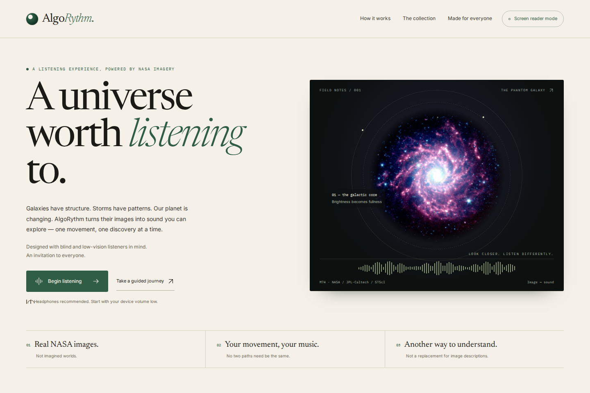

# AlgoRythm

**Hear the planet. And a little beyond.** A NASA-image listening experience for blind and low-vision listeners, classrooms and anyone curious about another way of understanding scientific imagery.

Built for [The Earth Information Jukebox](https://www.spaceappschallenge.org/2026/challenges/the-earth-information-jukebox/), NASA Space Apps 2026. Independent challenge project; not an official NASA product.



## A universe worth listening to

Galaxies have structure. Storms have patterns. Our planet is changing. AlgoRythm turns their images into sound you can steer: moving up produces higher notes, moving left and right changes spatial position, brightness changes fullness, and colour blends fixed instrument voices. It is **sonification**, not a recording from space. The scale, instruments, ambient bed and narration are deliberate interpretive choices.

The opening page now explains this story before asking for audio permission. Three translation steps teach the interaction; five collection cards open their real scene. **Begin listening** opens M74. **Take a guided journey** opens Hurricane Irma and starts its narrated tour. Screen reader mode is available before the spoken welcome. Browsing the introduction and pressing Tab do not autoplay audio.

## The collection

Five bundled NASA scenes with source links, baked grids and hand-authored, image-checked landmarks:

| Scene | Source | What to listen for |
|---|---|---|
| M74 — The Phantom Galaxy | Spitzer, `PIA08533` | Bright core, spiral arms and dust |
| Pillars of Creation | Hubble near-infrared, `GSFC_20171208_Archive_e000842` | Towers and the surrounding star field |
| Hurricane Irma, 6 September 2017 | Terra/MODIS via NASA GIBS | The quiet eye, eyewall and cloud bands |
| Earth at Night | VIIRS Black Marble via NASA GIBS | City lights and dark land and oceans |
| Mato Grosso, Brazil | Terra/ASTER, `PIA11420` | Closed forest and the same land after clearing |

NASA imagery is self-hosted. The exact source endpoints, crops and rejected candidates are recorded in [docs/sources.md](docs/sources.md). Every scene's official URL appears in its metadata and listening panel.

## Five ways to listen

**Explore:** drag or arrow-key through the image. A 16 × 12 grid translates position and local visual properties into sound. Rest on a landmark for narration, use H to jump to it, or select it in the panel.

**Journey:** follow a guided narrated path through the landmarks. The Journey selector actually starts the tour; pause and resume preserve the current stop. Manual exploration interrupts the automatic tour.

**Time Machine:** on Mato Grosso, blend the actual earlier forest crop into the later fields crop over approximately eight seconds, or use the continuous slider. This is an **image-based comparison**, not a numeric climate record. It does not replace the still-open Arctic sea-ice requirement.

**Blindfold:** hide the image while exploring, then reveal it. This is an alternative interaction, not evidence that the project has been validated by blind users.

**Sound Legend:** hear each of four fixed voices. The individual voice chips in How it sounds play the named instrument. Sequential legends and individual previews are cancellable.

The listening panel provides a source, landmarks, note/pan/level/filter readout, a mapping explanation, and an expandable transcript. The logo returns to the introduction, stops the old playback and keeps the screen-reader preference for the session.

## Accessibility and audio boundaries

The interface uses semantic headings and controls, visible focus, skip links, keyboard-operable actions and a `role="application"` listening stage. Focus enters the stage after it mounts and returns to the invoking control after dialogs close. Buttons retain native Enter/Space activation and sliders retain their arrow keys instead of also firing the global shortcuts.

Pre-generated MP3s provide a warm narrator, with browser SpeechSynthesis as a fallback. Text is mirrored into an `aria-live="polite"` region. **Screen reader mode turns off app narration**, leaving the transcript available. Reduced-motion preferences suppress decorative animations and automatic Journey gliding. No haptics are currently implemented.

The music uses parameter ramps, fixed voices and a final -3 dB limiter; narration ducks music by roughly 12 dB. These are digital mixing precautions, **not a guarantee of safe physical sound pressure**. Headphones are recommended for spatial listening; start with low device volume. Spatial cues require both audio channels.

## Run and build

```bash
npm ci
npm run dev          # Vite on http://localhost:5173
npm run build        # TypeScript + static production output in dist/
```

The current workspace is `/home/ubuntu/algorhythm`, connected to managed Preview. The original `/home/ubuntu/3sama` copy and private `sara-adel-x/algorhythm` repository are preserved separately. Saving a checkpoint is not publication. The standard Vite build remains deployable to Vercel; Vercel deployment has not been completed.

Python is needed only for offline scene building and optional focused checks:

```bash
python3 pipeline/meta_scenes.py
python3 pipeline/build_scene.py \
  --image pipeline/source/m74.jpg \
  --meta pipeline/meta/m74.json \
  --id m74 --out public/scenes/m74 --check

# With the dev server running and Python Playwright/Chromium installed:
python3 pipeline/check_landing.py
python3 pipeline/check_cancellation.py
```

`--check` renders marker overlays used to check landmark positions against each image. Scene building requires NumPy and Pillow. Browser checks require Python Playwright; they do not simulate assistive-technology users or validate a real iPhone.

## Implementation

| Module | Responsibility |
|---|---|
| `src/components/StartGate.tsx` | Structured introduction and explicit entry controls |
| `src/styles/landing.css` | Editorial responsive first page |
| `src/scene/useExperience.ts` | Entry, cancellation, Journey sequencing, comparison morph and narration state |
| `src/App.tsx` | Listening UI, keyboard shortcuts and overlays |
| `src/audio/engine.ts` | Fixed voices, drone, spatial audio, ramps, accents, limiter, cancellable previews |
| `src/audio/mapping.ts` | Pure brightness, hue, pitch, pan and edge mappings |
| `src/audio/narrator.ts` | Cancellable MP3/SpeechSynthesis playback and state subscriptions |
| `src/scene/registry.ts` | Static scene cache and neighbour navigation |
| `public/scenes/<id>/` | Self-hosted image, scene metadata and narration MP3s |
| `pipeline/` | Offline image analysis, content preparation and focused regression scripts |

The output path is `voices → lowpass/spatial processing → ducking and reverb → master gain → compressor → limiter → destination`. The lead has a lowpass cap of 3.5 kHz. At most two hue-weighted lead layers are audible in ordinary exploration; the scene's drone remains underneath.

| Visual property | Audio interpretation |
|---|---|
| Vertical frame position | Pitch quantized to the scene's scale, top = high |
| Horizontal frame position | HRTF spatial left/right position |
| Lightness | Lead level and filter, `min(3500, 180 × 18^(L^0.6))` Hz |
| Hue | Continuous blend among Warm, Hollow, Glass and Shimmer |
| Edge strength | Soft movement-triggered accent |
| Near-black, L < 0.06 | Very quiet lead with ambient drone |
| Whole-image histogram | Bounds of the drone's slowly varying filter |

## Keyboard

Arrows move one grid cell; Shift + arrow jumps four. H / Shift+H moves to the next / previous landmark. Space starts, pauses or resumes Journey. N / P selects the next / previous scene. T opens the comparison where available. B toggles Blindfold; R reveals it, otherwise repeats the last narration. L plays the legend, M toggles music mute, ? opens help, Enter describes the listening point, and Esc stops music and narration. Global shortcuts do not override focused form controls or buttons.

## Verification and remaining work

The first-page increment passes a production build and focused Chromium probes for deliberate entry, pre-entry screen-reader preference, guided Irma routing, mounted-stage focus, single Space activation, home preference retention, actual comparison crops, cancellation/re-entry, dialog focus and mobile viewport overflow. A read-only code review identified async cancellation gaps and misleading copy; these were corrected. Check outputs are in `design/shots/*-checks.json`.

Still open: real-device Safari/iOS and NVDA/VoiceOver tests; usability sessions with blind/low-vision users; numeric Arctic sea-ice Time Machine; target 6–8 polished scenes; offline service-worker caching; optional NASA proxy/cache bonus; and submission video or slides. The app bundles assets but has not yet been made fully offline-capable. See [TODO.md](TODO.md) and [plan.md](plan.md). The initial proposal in `docs/plan.md` is historical, not the current scope.

## Credits and AI-use disclosure

NASA/JPL-Caltech/STScI, NASA GIBS/Worldview, NASA Scientific Visualization Studio, and the Spitzer, Hubble, Terra/MODIS, VIIRS and ASTER instrument teams. NASA imagery and credit lines are retained; images may be resized or cropped for scene packaging. Source dates can be publication dates rather than complete observation metadata.

Prior work includes NASA and Chandra's sonifications, *A Universe of Sound*, STScI's Astronify, STRAUSS, herakoi, vOICe and EyeMusic. AlgoRythm makes no claim to be the first or a substitute for scientific image descriptions.

Implementation and drafting were AI-assisted. Narration audio was generated using TTS. Landmarks are authored interpretations checked against the displayed NASA frames; they have not been independently reviewed by NASA scientists. AI-generated audio is narration, not physical sound from the depicted scenes.

Code is MIT-licensed. NASA and partner imagery follows its applicable source usage guidance; see the retained credits. No accounts, uploaded audio or user database are required.
