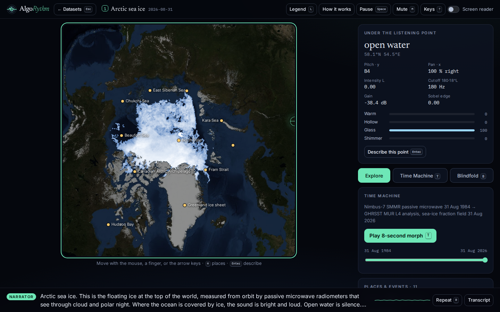

# AlgoRythm

**Hear our changing planet.** AlgoRythm is an Earth Information Jukebox: it fetches real NASA Earth-observation data, analyses the pixels in your browser, and turns the measurements into sound you can steer with a keyboard, mouse or finger. It is built for blind and low-vision listeners, classrooms and anyone curious about a different way into climate data.

Built for [The Earth Information Jukebox](https://www.spaceappschallenge.org/2026/challenges/the-earth-information-jukebox/), NASA Space Apps Challenge 2026. Independent challenge project; not an official NASA product.



## What you hear

The first screen is dark and has no images. It has one large **Enter Earth Jukebox** button and a screen-reader switch. Nothing makes a sound until you press it. That gesture starts the Web Audio context (`Tone.start()`), and a recorded narrator explains the keys. Then you pick one of seven live NASA datasets:

| # | Dataset | NASA source (fetched live through `/api/nasa`) | Time Machine |
|---|---|---|---|
| 1 | Arctic sea ice | GIBS `SSMIS_Sea_Ice_Concentration` (31 Aug 1984) and `GHRSST_L4_MUR_Sea_Ice_Concentration` (31 Aug 2026), EPSG:3413 | 1984 → 2026, measured extent |
| 2 | Global air temperature | GIBS `MERRA2_2m_Air_Temperature_Assimilated_Monthly` | same month 1980 → latest |
| 3 | Sea surface temperature | GIBS `GHRSST_L4_MUR_Sea_Surface_Temperature`, latest day | — |
| 4 | Rain and snow | GIBS `IMERG_Precipitation_Rate`, latest day, plus open EONET storms | — |
| 5 | Severe storms | EONET v3 open storms, framed on GIBS VIIRS NOAA-20 true colour on the storm's date | — |
| 6 | Wildfires | EONET v3 open fires, VIIRS true colour plus VIIRS NOAA-21 375 m thermal detections | — |
| 7 | Volcanoes | EONET v3 volcanoes (open, or the past 365 days when none are open) | — |

Each dataset also links its NASA Scientific Visualization Studio story (title, description and official URL), its exact GIBS request and a Worldview link for the same layer and date.

## How sound is made from data

Every frame is requested through our proxy, so the browser can draw it onto an `OffscreenCanvas` (in a Web Worker) and read the pixels without CORS errors. The analyser (`src/analysis/analyze.ts`) computes the following, live, for every frame:

- **Measured values.** For data layers, each pixel colour is inverted through NASA's official GIBS colormap XML back to the physical value (°C, mm/h, ice fraction). No-data and land pixels are separated from real values.
- **A 128-column feature grid.** Per cell: HSL, luminance, a hue spectrum, Sobel edge strength, the decoded value and its coverage.
- **Frame statistics.** Area-weighted means (cos latitude, or the polar-stereographic area for the Arctic) and sea-ice extent (≥ 15 % concentration).

These features drive persistent Tone.js voices, with every change smoothed by ramps:

| Data feature | Sound |
|---|---|
| Vertical position | Pitch, quantised to the dataset's scale (north = higher) |
| Horizontal position | Stereo / HRTF position |
| Intensity `L` (the measured value, or luminance for true colour) | Lowpass cutoff `180 × 18^L` Hz and gain |
| Hue spectrum | Crossfade between four timbres (Warm, Hollow, Glass, Shimmer) |
| Sobel edge strength | Soft percussive accent as you cross a boundary |
| Fire / thermal detections | Crackle |
| Whole-frame statistics | Ambient bed: pink noise and a harmonic drone, shaped by mean intensity and coverage |

The mix passes through a convolution reverb loaded with **real acoustic impulse responses** (Voxengo, royalty-free; files in `public/ir/`). Then comes a compressor, then a limiter. While the narrator speaks, the music ducks by 12 dB.

## Time Machine

On sea ice and air temperature, **T** plays the earlier frame, then morphs to the later one over eight seconds while the listening point sweeps the map. Pitch, cutoff, gain and timbre are interpolated cell by cell between the two real analyses, so the sound changes exactly as much as the data does. At the end the app shows and speaks the measured result. On the current frames that is:

- **Arctic sea-ice extent:** 7.1 million km² on 31 Aug 1984 → 4.2 million km² on 31 Aug 2026 (−41 %, measured from these two frames).
- **Mean 2 m air temperature:** 16.1 °C (Aug 1980) → 17.0 °C (Aug 2026), +0.9 °C for that month.

These are measurements from two single-day (or single-month) frames, not trend analyses. The two sea-ice frames also come from different sensors and products. NASA's long-term records remain the authority.

## Narration

The narrator is a real, pre-generated TTS voice: 39 MP3 clips, about 12 minutes, normalised to −18 LUFS. A clip plays **only if its recorded text exactly matches the sentence the app is about to say** (`public/narration/manifest.json`). So a recording can never contradict live data. When EONET publishes a new event or a new storm position, that line is shown as text only until it is re-recorded with `pipeline/bake_narration.py`. There is no browser SpeechSynthesis voice anywhere. Every line also goes to the visible caption bar, the transcript and an `aria-live="polite"` region.

**Screen-reader mode** (available on the first screen and remembered) turns off the recorded voice, so your own screen reader reads the live region instead.

## Keyboard

| Key | Action |
|---|---|
| ↑ ↓ / 1–7, Enter | Choose a dataset |
| Arrows (Shift = faster) | Move the listening point |
| H / Shift+H | Next / previous place or event |
| Enter | Describe the point (place, coordinates, measured value) |
| T | Time Machine |
| B, then V | Blindfold: hide the picture, then reveal it |
| L | Sound legend |
| N / P | Next / previous EONET event |
| Space | Pause / resume |
| M | Mute |
| R | Repeat the last line |
| ? | All keys |
| Esc | Leave the mode, then go back to the datasets |

## Architecture

```
browser ── /api/nasa/* ──► server/nasa.mjs ──► GIBS WMS · GIBS colormaps · EONET v3 · NASA Images API · SVS API
   │                        (whitelisted ids only, memory LRU + disk cache, stale-on-error)
   ├─ src/analysis/   worker: decode frame → colormap inversion → feature grid + stats
   ├─ src/audio/      engine (voices, ambience, convolver, ducking, limiter), mapping, narrator
   ├─ src/app/        useJukebox controller, model (landmarks, place names, sweep)
   └─ src/components/ Gate, DatasetSelector, Stage, ListenPanel, Dialogs, Visualizer
```

The browser only ever sends dataset and event ids. Upstream URLs, layers and bounding boxes live in `server/catalog.mjs`. The same proxy runs inside Vite during development (`vite.config.ts`) and in production (`server/index.mjs`, Node built-ins only).

## Run

```bash
npm ci
npm run dev                     # http://localhost:5173 (app + /api/nasa)
npm run build                   # static app in dist/
node server/index.mjs           # production: /api/health, /api/nasa/*, and dist/ on $PORT (default 3000)
docker build -t algorhythm .    # same, as a container
```

Checks (Python Playwright + Chromium, with the dev server running):

```bash
python3 pipeline/e2e.py                  # all 7 datasets, Time Machine, Blindfold, dialogs, mobile; fails on console errors or direct NASA calls
python3 pipeline/bake_narration.py plan  # which live sentences still need recording
python3 pipeline/bake_narration.py build # wav → mp3 + manifest
```

## Limits and honesty notes

- This is sonification: an interpretive mapping of measured data to sound, not a recording of anything physical.
- Live EONET content changes. Event narration is generated from EONET fields (title, date, coordinates, magnitude, source) and nothing else.
- Data depends on NASA's services being up. The proxy caches every response (images for 30 days, events for 10 minutes) and serves stale data if an upstream fails.
- Not yet tested with NVDA/VoiceOver on real devices or with blind and low-vision users. That comes next.

## Credits and AI-use disclosure

Data: NASA GIBS / Worldview, NASA EONET, NASA GMAO MERRA-2, JPL GHRSST MUR, NASA GPM IMERG, NSIDC/NASA passive-microwave sea-ice records, VIIRS (NOAA-20), NASA Scientific Visualization Studio and the NASA Image and Video Library. Impulse responses: Voxengo (royalty-free). Prior art: NASA/Chandra sonifications, *A Universe of Sound*, Astronify, STRAUSS, herakoi.

Implementation was AI-assisted, and narration audio was generated with TTS from the exact on-screen text. Code is MIT-licensed.
